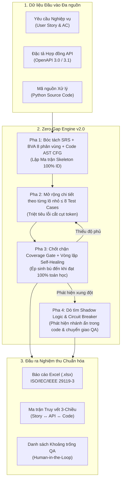

# 🚀 AI QA Assistant — Enterprise Test Design & Zero-Gap Verification Platform

[](https://www.python.org/)
[](https://fastapi.tiangolo.com/)
[](https://react.dev/)
[](https://www.typescriptlang.org/)
[](https://www.istqb.org/)
[](#-zero-gap-engine-v20)

**AI QA Assistant** là nền tảng kiểm thử phần mềm thông minh thế hệ mới, kết hợp sức mạnh của **Mô hình Ngôn ngữ Lớn (LLM - Gemini / GPT)** với **Toán học Tất định (Deterministic Mathematics)** và **Phân tích Cú pháp Tĩnh Mã nguồn (Python AST Code CFG)**. 

Hệ thống giải quyết triệt để vấn đề "ảo giác" (hallucination), "bỏ sót điều kiện biên" và "độ phủ ảo" của AI truyền thống, đảm bảo **100% độ phủ kiểm thử toán học** trước khi phát hành phần mềm.

---

## 🌟 Điểm Nhấn Kiến Trúc: Zero-Gap Engine v2.0

Không giống các công cụ sinh test case thông thường phụ thuộc 100% vào prompt của AI, AI QA Assistant áp dụng triết lý:
> **"Determinism First, AI as a Copywriter"**  
> *(Toán học & Code AST nắm quyền kiểm soát bộ khung, AI đóng vai trò thư ký diễn đạt).*



---

## ⚡ Các Tính Năng Nổi Bật

### 1. 🛡️ Bộ đo Chất lượng Yêu cầu theo Thời gian thực (Live Quality Meter)
* **Chấm điểm 5/5 tiêu chuẩn**: Đánh giá độ rõ ràng của tiêu đề, mô tả User Story, số lượng AC ($\ge 2$), kịch bản lỗi/biên và quy tắc nghiệp vụ.
* **Thư viện 5 Domain Templates**: Cung cấp mẫu chuẩn có sẵn cho *Fintech Ví điện tử, Thương mại điện tử (E-Commerce), Đăng ký SaaS, Đặt lịch Y tế (Healthcare)* và *Quản lý Công việc*.
* **AC Quick Inserters**: Chèn nhanh các mệnh đề nghiệm thu kinh điển chỉ với 1 cú click.

### 2. 🔍 Kiểm toán Hợp đồng API & Phát hiện Shadow Logic
* **Đối soát chéo 3-Chiều (3-Way Verification)**: Phát hiện ngay lập tức khi mã nguồn chứa nhánh `if/else` (Shadow Logic) mà User Story và OpenAPI không hề mô tả.
* **Ma trận BVA 8 Phân vùng Tất định**: Tự động tính toán các mốc biên chết: `min - 1`, `min`, `nominal`, `max`, `max + 1`, `null`, `empty`, `wrong_type`.
* **Phân tích Cú pháp AST CFG**: Đo đếm độ phức tạp chu trình Cyclomatic Complexity $V(G)$ trực tiếp từ cây cú pháp mã nguồn Python.

### 3. 🎯 Liêm chính Bằng chứng Kiểm thử (Assertion Evidence)
* **Triệt tiêu "Độ phủ ảo" (False Coverage)**: Ngăn chặn việc gắn mã ID hình thức. Hệ thống bắt buộc mọi mục tiêu được đánh dấu `COVERED` phải trích dẫn nguyên văn câu lệnh kiểm tra kết quả (`assertion`) từ kịch bản thực tế.
* **Bảng điều khiển Quyết định QA (Human-in-the-Loop)**: Cho phép QA linh hoạt đưa ra quyết định: *Xác nhận Assertion, Chấp nhận rủi ro (Accepted Risk), Hoãn lại (Deferred), Bị chặn (Blocked)* hoặc *Không áp dụng*.

### 4. 📊 Xuất Báo cáo Excel Chuẩn Quốc tế (ISO/IEC/IEEE 29119-3 & ISTQB)
Xuất file `.xlsx` chuyên nghiệp với 3 Sheet được định dạng tối ưu:
* **Sheet 1 (`Danh sách Test Case`)**: 21 cột chi tiết, màu sắc badge ưu tiên, text wrapping, auto-filter toàn bảng và freeze panes.
* **Sheet 2 (`Ma trận Phủ - Coverage Matrix`)**: Bảng liên kết 1-1 giữa mục tiêu nghiệm thu và câu trích dẫn bằng chứng xác thực nghiệp vụ.
* **Sheet 3 (`Tổng quan & KPI`)**: Dashboard trực quan phân bổ theo độ ưu tiên và phân loại kiểm thử.
* Hỗ trợ xuất cả ở **Test Workbench** lẫn **Zero-Gap Engine Panel**.

---

## 🛠️ Công Nghệ Sử Dụng

| Tầng kiến trúc | Công nghệ chính | Vai trò |
| :--- | :--- | :--- |
| **Backend** | Python 3.11, FastAPI, Uvicorn | Xử lý API, tính toán toán học, bóc tách AST & BVA |
| **Database** | PostgreSQL 16, SQLAlchemy 2.0, Alembic | Lưu trữ thực thể Story, Review, TestCaseSet có versioning |
| **Excel Engine** | OpenPyXL | Render bảng tính Excel đạt chuẩn ISO 29119-3 |
| **AI Providers** | Google Gemini (`gemini-2.5-pro`), OpenAI (`gpt-4o`) | Diễn đạt câu từ, mở rộng kịch bản kiểm thử theo lô nhỏ |
| **Frontend** | React 19, TypeScript, Vite, Lucide Icons | Giao diện điều khiển SPA mượt mà, phản hồi thời gian thực |

---

## 🚀 Cài Đặt & Khởi Chạy Nhanh

### Cách 1: Chạy bằng Docker Compose (Khuyên dùng)

1. Sao chép file cấu hình môi trường:
   ```bash
   cp .env.example .env
   ```
2. Điền API Key của bạn (`GEMINI_API_KEY` hoặc `OPENAI_API_KEY`) vào file `.env`.
3. Khởi chạy toàn bộ hệ thống bằng Docker:
   ```bash
   docker compose up --build
   ```
4. Truy cập ứng dụng:
   * **Giao diện Web**: [http://localhost:5173](http://localhost:5173)
   * **API Docs (Swagger UI)**: [http://localhost:8000/docs](http://localhost:8000/docs)

---

### Cách 2: Chạy trực tiếp trên máy cục bộ (Local Development)

#### 1. Khởi động Backend:
```powershell
cd backend
python -m venv .venv
.venv\Scripts\activate
pip install -r requirements-dev.txt
alembic upgrade head
python -m uvicorn app.main:app --host 127.0.0.1 --port 8000 --reload
```

#### 2. Khởi động Frontend:
```powershell
cd frontend
npm install
npm run dev
```
Mở trình duyệt tại [http://localhost:5173](http://localhost:5173).

---

## ⚙️ Cấu Hình AI Provider (`.env`)

Hệ thống hỗ trợ chuyển đổi linh hoạt giữa Google Gemini và OpenAI:

```dotenv
# Cấu hình sử dụng Google Gemini (Mặc định khuyên dùng)
AI_PROVIDER=gemini
GEMINI_API_KEY=your_gemini_api_key_here
GEMINI_MODEL=gemini-2.5-pro

# Hoặc cấu hình sử dụng OpenAI
# AI_PROVIDER=openai
# OPENAI_API_KEY=your_openai_api_key_here
# OPENAI_MODEL=gpt-4o
```

---

## 🧪 Kiểm Thử & Đảm Bảo Chất Lượng

Hệ thống đi kèm bộ kiểm thử tự động toàn diện bao phủ từ Unit Test, Integration Test đến Pipeline Validation:

```powershell
# Chạy toàn bộ test suite Backend (100% passed)
cd backend
python -m pytest

# Kiểm tra TypeScript và Build Frontend
cd ../frontend
npm run build
```

---

## 📂 Cấu Trúc Dự Án

```text
AI_QA_Assistant/
├── backend/
│   ├── app/
│   │   ├── api/            # Router API endpoints (RESTful)
│   │   ├── engine/         # Lõi Zero-Gap (gap_detector, batch_generator, coverage_gate)
│   │   ├── parsers/        # Bóc tách SRS, OpenAPI BVA 8 phân vùng, Python AST CFG
│   │   ├── schemas/        # Pydantic v2 Contract Models & DTOs
│   │   ├── services/       # AI Providers, Workflow Service, Excel Export Service
│   │   └── models.py       # SQLAlchemy ORM Database Entities
│   └── tests/              # Test suite tự động (Pytest)
├── frontend/
│   ├── src/
│   │   ├── ReviewPanels.tsx    # Live Quality Meter & Form tạo Story
│   │   ├── TestWorkbench.tsx   # Quản lý Test Cases, Bằng chứng & Xuất Excel
│   │   ├── ZeroGapPanel.tsx    # Bảng điều khiển Zero-Gap Engine 3-Way
│   │   ├── SuiteAssessment.tsx # Đánh giá điều kiện chạy & Quyết định QA
│   │   └── api.ts              # HTTP Client & Blob Export Handler
│   └── package.json
├── docker-compose.yml
├── openapi.yaml            # File đặc tả API mẫu kiểm thử
├── service.py              # File mã nguồn mẫu kiểm thử AST
└── README.md
```

---

## 📄 Bản Quyền & Giấy Phép

Phát triển bởi đội ngũ kỹ sư kiểm thử & AI. Được phân phối dưới giấy phép **MIT License**. Mọi đóng góp (Pull Request) và ý kiến cải tiến luôn được hoan nghênh!
