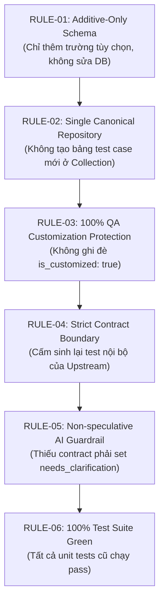
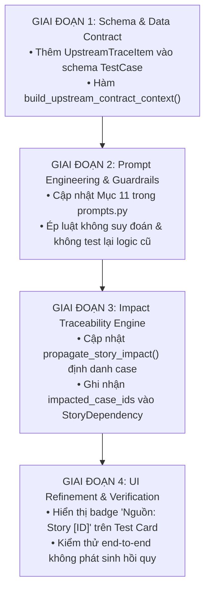

# KẾ HOẠCH TRIỂN KHAI TÍCH HỢP HỢP ĐỒNG THƯỢNG NGUỒN & QUẢN TRỊ TÁC ĐỘNG TEST CASE (V4.0)
## Chuẩn Hóa Dữ Liệu Liên Story – Loại Bỏ Sự Mơ Hồ Khi Sinh Test Cases
**Tài liệu:** `planUpstreamContractIntegration.md`  
**Phiên bản:** v4.0-Enterprise  
**Trạng thái:** DRAFT / SẴN SÀNG THẨM ĐỊNH & THỰC THI  
**Mục tiêu cốt lõi:** Loại bỏ triệt để tình trạng AI sinh test case "mơ hồ / đoán mò", chuyển đổi dữ liệu Thượng nguồn (Upstream) thành Hợp đồng dữ liệu có cấu trúc (Structured Contract) trong từng Story, tuân thủ nguyên tắc **"Một nơi lưu duy nhất (Single Source of Truth)"** và **Bộ Quy Tắc Bất Biến Không Làm Hỏng Hệ Thống (Zero-Regression)**.

---

## 1. BỐI CẢNH & NGUYÊN TẮC CỐT LÕI

### 1.1. Vấn Đề Hiện Hữu (The Core Problem)
1. **AI bị "mù" dữ liệu Thượng nguồn:** Khi đứng tại Story con (ví dụ: `Checkout`) và bấm *Sinh Test Case*, hệ thống chỉ truyền dữ liệu cục bộ của Story con. AI không biết Story cha (`CART-01`) sản sinh ra token gì, `cart_id` định dạng thế nào, dẫn đến việc AI phải tự bịa ra các dữ liệu mẫu (`cart_id: 123`) và precondition mơ hồ (`"Người dùng đã có giỏ hàng hợp lệ"`).
2. **Nguy cơ lan man / phân mảnh nếu sinh test ở nhiều nơi:** Nếu tạo thêm tính năng "Sinh E2E Suite" ở Story Collections, test case sẽ bị nhân bản ở 2 nơi (vừa ở Story, vừa ở Collection), gây khó khăn cho việc bảo trì, gây lệch pha và rác dữ liệu.
3. **Quản trị tác động chưa truy vết đến cấp Test Case:** Khi Story cha thay đổi version, hệ thống chỉ báo chung chung ở cấp Story, chưa định danh chính xác test case nào của Story con đang tiêu thụ trường dữ liệu (`consumed_outputs`) bị thay đổi.

### 1.2. 5 Nguyên Tắc Bất Biến Khi Triển Khai (Design Principles)
> [!IMPORTANT]
> **NGUYÊN TẮC VÀNG:**
> 1. **Một nơi lưu trữ duy nhất (Single Source of Truth):** Toàn bộ test case chỉ được tạo, sửa và lưu trữ tại **Tab `Test Cases` của từng Story**. Tuyệt đối không sinh hay lưu bộ test case riêng tại Story Collection hay Graph.
> 2. **Collection / Graph chỉ lưu quan hệ & tham chiếu (Reference-Only):** Collection/Graph đóng vai trò làm bản đồ điều hướng, hiển thị luồng và tham chiếu đến test case có sẵn của các Story thành viên.
> 3. **Hợp đồng dữ liệu có cấu trúc (Structured Data Contract):** AI chỉ được nạp dữ liệu Thượng nguồn theo schema rõ ràng (Story nguồn, Output $\to$ Input, Điều kiện sử dụng, Mã lỗi đã xác nhận).
> 4. **Tuyệt đối không suy diễn – Thiếu là đánh dấu `needs_clarification`:** Không biến giả định thành `expected_result` chính thức nếu đặc tả chưa quy định.
> 5. **Không kiểm thử lại logic nội bộ của Story nguồn:** Story con chỉ kiểm tra điểm giao tiếp (Handshake / Boundary / Error Handling), không test lại logic nội bộ của Story cha.

---

## 2. BỘ 6 QUY TẮC AN TOÀN BẢO VỆ HỆ THỐNG (STRICT SAFETY INVARIANTS)



1. **RULE-01 (Additive-Only Schema):**
   * Bảng CSDL `test_case_sets` lưu trữ nội dung dưới dạng cột `content: JSON`.
   * Việc bổ sung trường truy vết `upstream_traceability` vào Pydantic model `TestCase` được khai báo với giá trị mặc định `default_factory=list`. 
   * **Không yêu cầu migrate CSDL**, không làm vỡ các test case cũ đã lưu trong DB.
2. **RULE-02 (Single Canonical Repository):**
   * Không tạo bảng mới cho "Collection Test Suites". Không lưu trữ bản sao test case.
   * Rà soát hiện trạng: Module `StoryCollection` hiện tại chỉ quản lý thành viên (`collection_story_members`) và xuất Postman từ test cases của Story thành viên $\rightarrow$ **Xác nhận 100% sạch, không có dữ liệu phân mảnh cần dọn dẹp**.
3. **RULE-03 (100% QA Customization & Approval Protection):**
   * Khi Story Thượng nguồn thay đổi, hệ thống chỉ cập nhật cờ `stale: true` và `impact_status: "stale"` kèm danh sách `impacted_case_ids`.
   * **Tuyệt đối không tự ý xóa, sửa hay ghi đè nội dung của test case** mà QA đã chỉnh sửa thủ công (`is_customized: true`) hoặc đã duyệt (`review_status: "approved"`).
4. **RULE-04 (Strict Contract Boundary):**
   * Prompt chỉ thị rõ: *"Không sinh lại các ca kiểm thử nội bộ của Story nguồn. Chỉ kiểm thử cách Story hiện tại tiếp nhận, xác thực và phản hồi với dữ liệu/trạng thái từ Story nguồn."*
5. **RULE-05 (Non-speculative AI Guardrail):**
   * Mọi mã lỗi HTTP (ví dụ `400 CART_ALREADY_PROCESSED`) hoặc format dữ liệu chỉ được đưa vào `expected_result` chính thức khi có căn cứ trong OpenAPI Spec hoặc AC Thượng nguồn.
   * Nếu chưa có hợp đồng xác nhận: Bắt buộc gán `needs_clarification: true` và đưa câu hỏi vào `assumptions`.
6. **RULE-06 (Zero Test Regression):**
   * Toàn bộ 5/5 unit tests của `test_collection_engine.py` và các bài test workflow hiện hữu phải tiếp tục chạy `PASS 100%`.

---

## 3. THIẾT KẾ KIẾN TRÚC CHI TIẾT

### 3.1. Cấu Trúc Hợp Đồng Thượng Nguồn (Structured Upstream Contract)
Khi gọi AI sinh test cho Story hiện tại, backend sẽ truy vấn bảng `story_dependencies` để trích xuất các liên kết mà Story này là `target_story_id`.

Dữ liệu nạp vào `story_payload(story)` sẽ được bổ sung mục `upstream_contracts`:

```json
{
  "upstream_contracts": [
    {
      "source_story_id": "CART-01",
      "source_story_title": "Quản lý giỏ hàng",
      "source_version": 2,
      "dependency_type": "data_fixture",
      "relationship_summary": "Story hiện tại sử dụng giỏ hàng do CART-01 tạo ra để thanh toán",
      "data_mappings": [
        {
          "output_field": "cart.id",
          "consumed_input": "checkout.cart_id",
          "description": "Mã định danh giỏ hàng cần thanh toán"
        },
        {
          "output_field": "cart.total_amount",
          "consumed_input": "checkout.amount",
          "description": "Tổng số tiền giỏ hàng tính từ CART-01"
        }
      ],
      "usage_preconditions": [
        "Giỏ hàng phải thuộc sở hữu của người dùng hiện tại",
        "Trạng thái giỏ hàng phải là 'active'"
      ],
      "confirmed_error_rules": [
        "Nếu giỏ hàng không tồn tại hoặc đã checkout -> Từ chối thanh toán theo mã lỗi quy định trong API contract"
      ],
      "source_reference": "AC-01 của Story CART-01 (v2)"
    }
  ]
}
```

### 3.2. Cập Nhật Schema `TestCase` (Thêm Truy Vết Thượng Nguồn)
Trong file `backend/app/schemas/__init__.py`:

```python
class UpstreamTraceItem(BaseModel):
    source_story_id: str
    source_story_title: str | None = None
    source_version: int
    consumed_fields: list[str] = Field(default_factory=list)
    bound_rules: list[str] = Field(default_factory=list)
    contract_reference: str | None = None

class TestCase(BaseModel):
    id: str = Field(pattern=r"^TC-[A-Za-z0-9_-]+$")
    title: str = Field(min_length=1, max_length=240)
    # ... Các trường hiện hữu giữ nguyên 100% ...
    upstream_traceability: list[UpstreamTraceItem] = Field(
        default_factory=list,
        description="Truy vết chi tiết đến Story thượng nguồn và trường dữ liệu hợp đồng"
    )
```

### 3.3. Tinh Chỉnh Prompt AI (`backend/app/services/prompts.py`)
Bổ sung Mục 11 chuyên biệt vào `test_case_input`:

```text
11. UPSTREAM CONTRACT & INTERFACE VERIFICATION

When upstream_contracts are supplied:
A. Precise Input Provenance:
   - Identify preconditions and test_data using the exact output fields from upstream stories.
   - Explicitly label whether a value is a source fixture output (e.g. "Lấy cart.id từ Story [CART-01]") or a local test input.

B. Handshake and Interface Boundary Testing:
   - Generate test cases verifying how this story handles valid, missing, expired, or invalid data received from upstream.
   - Do NOT test upstream's internal logic (e.g. do not re-test how CART-01 adds products or calculates discounts; test only how Checkout responds when receiving that cart).
   - Base error assertions on confirmed contract rules. If error codes or behaviors are not explicitly specified in the contract or story, mark needs_clarification=true and record the question in assumptions.

C. Upstream Traceability Linkage:
   - For every test case that exercises an upstream dependency, populate upstream_traceability with:
     source_story_id, source_version, consumed_fields, and contract_reference.
```

### 3.4. Quản Trị Tác Động Cấp Test Case (Granular Impact Propagation)
Khi một Story Thượng nguồn (`CART-01`) thay đổi từ version 1 lên version 2:
1. `propagate_story_impact` quét các `StoryDependency` liên quan.
2. Kiểm tra các test case trong Story con:
   * Test case nào có `upstream_traceability.source_story_id == "CART-01"` và sử dụng các trường dữ liệu bị chỉnh sửa $\rightarrow$ Thêm ID vào `impacted_case_ids`.
   * Đánh dấu test case đó với nhãn giao diện: **"Cần rà soát (Upstream v1 $\rightarrow$ v2)"**.
   * Nêu rõ lý do cụ thể trong `stale_reason` (ví dụ: *"Trường cart.total_amount ở Story CART-01 đã đổi logic"*).
   * **Giữ nguyên 100% nội dung và assertions hiện tại** để QA tự quyết định duyệt hay sửa đổi.

---

## 4. LỘ TRÌNH TRIỂN KHAI 4 GIAI ĐOẠN (ROADMAP)



### Giai Đoạn 1: Cấu Trúc Hóa Hợp Đồng & Mở Rộng Schema (Backend Core)
* **File ảnh hưởng:**
  * `backend/app/schemas/__init__.py`: Thêm `UpstreamTraceItem` và trường `upstream_traceability` vào `TestCase`.
  * `backend/app/services/dependency_graph.py`: Xây dựng hàm `extract_upstream_contracts(db, story_id)` lấy toàn bộ hợp đồng Thượng nguồn của Story con.
  * `backend/app/services/prompts.py`: Đưa `upstream_contracts` vào `story_payload(story)`.
* **Tiêu chí hoàn thành:** Chạy unit tests schemas, không có lỗi import, tương thích ngược 100% với dữ liệu cũ.

### Giai Đoạn 2: Nâng Cấp Prompt Sinh Test Case & Cơ Chế Chặn Suy Đoán
* **File ảnh hưởng:**
  * `backend/app/services/prompts.py`: Thêm chỉ thị Mục 11 trong `test_case_input` và bộ kiểm tra `valid_traceability_ids`.
  * `backend/app/services/workflow.py`: Đảm bảo validator chấp nhận `upstream_traceability`.
* **Tiêu chí hoàn thành:** AI sinh test case thể hiện rõ nguồn dữ liệu đầu vào (ví dụ: `Lấy từ CART-01`), các ca thiếu mã lỗi chính thức tự động bật `needs_clarification: true`. Không sinh lại test thêm/sửa giỏ hàng.

### Giai Đoạn 3: Nâng Cấp Quản Trị Tác Động Đến Cấp Test Case
* **File ảnh hưởng:**
  * `backend/app/services/dependency_graph.py`: Hàm `propagate_story_impact` đọc `upstream_traceability` của từng test case để so khớp với delta thay đổi của Story cha.
  * `backend/app/services/resync_engine.py`: Bảo toàn 100% test case đã được QA chỉnh sửa (`is_customized: true`), thông báo rõ lý do cần rà soát.
* **Tiêu chí hoàn thành:** Khi Story cha tăng version, Story con định danh chính xác test case nào bị ảnh hưởng thay vì chỉ cảnh báo toàn Story.

### Giai Đoạn 4: Hoàn Thiện Giao Diện Hiển Thị & Kiểm Thử Toàn Diện
* **File ảnh hưởng:**
  * `frontend/src/TestWorkbench.tsx`: Hiển thị chip nguồn dữ liệu: `🔗 Nguồn: CART-01 (cart.id)` trên từng test case có liên kết Thượng nguồn.
  * `frontend/src/StoryJourneyGraphPanel.tsx`: Giữ nguyên chức năng quan hệ và tham chiếu, làm rõ ràng trạng thái tác động.
* **Tiêu chí hoàn thành:** Build frontend với `npm run build` đạt 0 lỗi, kiểm thử thực tế với cặp Story Đăng nhập $\rightarrow$ Giỏ hàng $\rightarrow$ Thanh toán.

---

## 5. TIÊU CHÍ NGHIỆM THU CHI TIẾT (ACCEPTANCE CRITERIA)

| STT | Tiêu chí nghiệm thu | Phương thức kiểm tra | Kết quả kỳ vọng |
| :---: | :--- | :--- | :--- |
| **AC-01** | Không còn chức năng sinh suite riêng tại Collection | Rà soát codebase & UI | Test case chỉ sinh và lưu duy nhất tại tab `Test Cases` của Story. Collection chỉ điều hướng và tham chiếu. |
| **AC-02** | Thể hiện rõ nguồn dữ liệu Thượng nguồn trong Test Case | Sinh test cho Story có Upstream | Preconditions & Test Data ghi rõ `[Lấy từ Story-XXX]`, không sinh dữ liệu tự bịa mơ hồ. |
| **AC-03** | Chặn tự suy đoán mã lỗi / hợp đồng chưa xác nhận | Test kịch bản thiếu hợp đồng lỗi | AI tự động gán `needs_clarification: true`, không tự biến mã lỗi giả định thành expected result. |
| **AC-04** | Không sinh trùng lặp logic nội bộ Story nguồn | So sánh test suite Story cha và con | Story con chỉ kiểm tra hành vi nhận/xử lý tại điểm giao tiếp, không test lại hàm nội bộ của Story cha. |
| **AC-05** | Quản trị tác động lưu dấu vết đến từng test case | Thay đổi version Story cha | Chỉ các test case có dùng trường dữ liệu bị đổi mới gắn cờ `Cần rà soát`, test case QA đã sửa được giữ nguyên 100%. |
| **AC-06** | Tính tương thích ngược 100% | Chạy toàn bộ test suites hiện có | Các Story Standalone (không có Upstream) sinh test bình thường như cũ, không phát sinh lỗi schema. |

---

## 6. KẾ HOẠCH ROLLBACK DỰ PHÒNG (CONTINGENCY PLAN)

1. **Khả năng đảo ngược tức thì (Zero-Risk Rollback):**
   * Do không thêm/sửa bảng CSDL vật lý (chỉ mở rộng trường Pydantic JSON và bổ sung ngữ cảnh Prompt), nếu cần rollback chỉ cần revert các commit trong `prompts.py` và `dependency_graph.py`.
   * Toàn bộ dữ liệu hiện tại vẫn nguyên vẹn 100%, không cần chạy migration rollback trong Alembic.
2. **Kiểm thử tự động trước khi đóng gói:**
   * `pytest backend/tests` đạt 100% pass.
   * `cd frontend && npm run build` đạt 0 warnings/errors.
