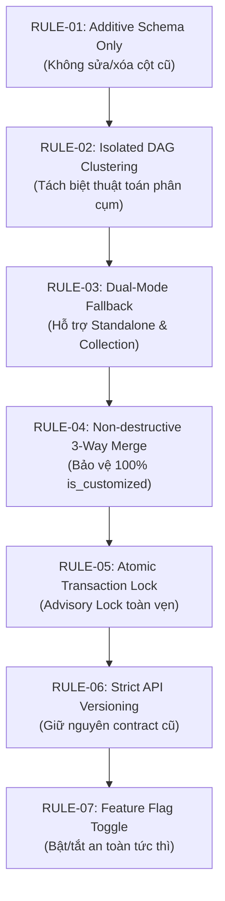
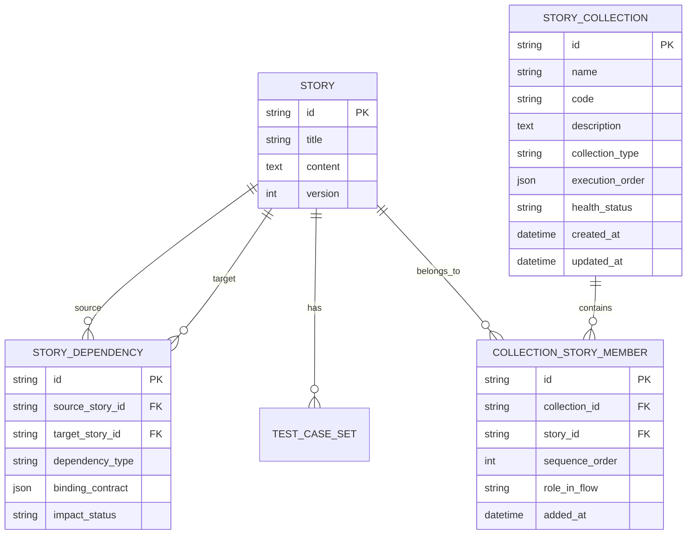
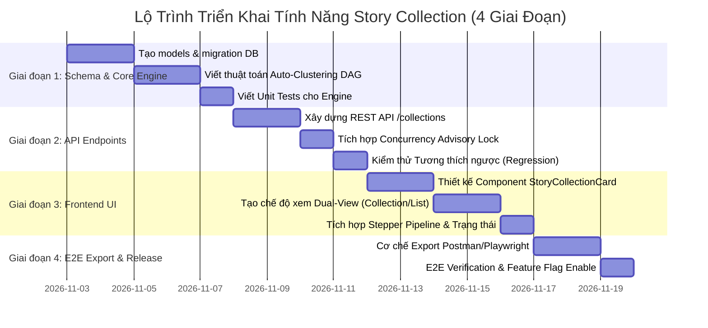

# KẾ HOẠCH TRIỂN KHAI TÍNH NĂNG STORY COLLECTION (V3.0)
## Hệ Thống Quản Trị Luồng Phụ Thuộc Liên Story & Bộ Kịch Bản E2E Tự Động
**Tài liệu:** `plantStoryCollection.md`  
**Phiên bản:** v3.0-Enterprise  
**Trạng thái:** DRAFT / SẴN SÀNG THẨM ĐỊNH  
**Mục tiêu tối thượng:** Gom cụm tự động các User Story có liên kết ($\ge 2$ Story) thành **Collection**, loại bỏ 100% trùng lặp kịch bản kiểm thử, đồng thời tuân thủ **Bộ Quy Tắc Bất Biến Không Làm Hỏng Hệ Thống (Zero-Regression & Backward Compatibility)**.

---

## 1. BỐI CẢNH & NGUYÊN TẮC "KHÔNG LÀM HỎNG HỆ THỐNG"

### 1.1. Hiện Trạng & Thách Thức (The Pain Point)
1. **Phân mảnh dạng phẳng (Flat List Fatigue):** Hiện tại hệ thống hiển thị các Story độc lập. Khi số lượng Story tăng lên >20, QA không thể nhận diện luồng hành trình người dùng (User Journey) từ Đăng nhập $\rightarrow$ Giỏ hàng $\rightarrow$ Thanh toán.
2. **Trùng lặp công sức (Duplication of Test Work):** Kịch bản của Story nào cũng lặp lại bước Xác thực tài khoản (Auth/Session) hoặc Khởi tạo dữ liệu (Fixtures).
3. **Nguy cơ phá vỡ hệ thống nếu làm sai:** Việc can thiệp vào các bảng cốt lõi (`Story`, `StoryDependency`, `TestCaseSet`) nếu không có kế hoạch cách ly an toàn sẽ gây:
   * Lỗi khóa ngoại (Foreign Key Violation) trong SQLite/PostgreSQL.
   * Làm gãy thuật toán phát hiện chu trình Kahn trong `dependency_graph.py`.
   * Làm sai lệch logic 3-Way Merge và ghi đè mất các câu `is_customized: true` của QA.
   * Làm sập giao diện React (`TestWorkbench.tsx`, `StoryJourneyGraphPanel.tsx`).

### 1.2. Tuyên Ngôn An Toàn (Zero-Regression Manifesto)
> **"Mọi cải tiến mới đều mang tính Bổ Sung Gia Tăng (Additive Only) – Tuyệt đối không xóa, không sửa đổi phá vỡ (Breaking Changes) bất kỳ API, bảng CSDL hay logic nghiệp vụ hiện hữu."**

* **Tính tương thích ngược 100% (100% Backward Compatibility):** Một User Story chưa có liên kết (`UPSTREAM = 0` và `DOWNSTREAM = 0`) vẫn hoạt động bình thường như một **Standalone Story**, không bị ép buộc phải vào Collection.
* **Tách biệt tầng hiển thị (Presentation Layer) và tầng lưu trữ (Storage Layer):** Hệ thống hỗ trợ song song cả **Virtual Dynamic Collection** (tự động suy diễn từ đồ thị DAG mà không cần ghi thêm vào DB) và **Persistent Collection** (người dùng tự đặt tên, cấu hình nâng cao).

---

## 2. BỘ 7 QUY TẮC BẤT BIẾN (STRICT SAFETY INVARIANTS)

Để đảm bảo triển khai không gây hồi quy (regression), toàn bộ mã nguồn phải tuân thủ nghiêm ngặt 7 quy tắc sau:



* **RULE-01 (Additive Schema Only):** 
  * Cấm xóa, đổi tên hoặc thay đổi ràng buộc (constraints) của các bảng hiện hữu: `stories`, `story_dependencies`, `test_case_sets`, `reviews`, `api_contract_reviews`.
  * Bảng mới `story_collections` và `collection_story_members` phải sử dụng khóa ngoại mềm hoặc `ON DELETE CASCADE` được kiểm soát chặt chẽ qua Application Layer.
* **RULE-02 (Isolated DAG Clustering):** 
  * Thuật toán gom cụm Collection (Connected Components / Weakly Connected Components) phải chạy như một hàm phân tích độc lập (Pure Function), đọc từ đồ thị DAG hiện tại mà không làm thay đổi cấu trúc bảng `story_dependencies`.
* **RULE-03 (Dual-Mode Fallback on UI):** 
  * Giao diện React luôn có nút chuyển đổi góc nhìn: `[Chế độ Collection (Mặc định)]` $\longleftrightarrow$ `[Chế độ Danh Sách Đơn Phẳng (Classic List)]`. Nếu có bất kỳ lỗi render nào ở Collection, giao diện tự động fallback về Classic List.
* **RULE-04 (Non-Destructive 3-Way Merge Engine):** 
  * Cơ chế lan truyền thay đổi (Impact Propagation) từ Thượng nguồn xuống Hạ nguồn chỉ tác động vào `preconditions` và `test_data`. Tuyệt đối không can thiệp vào `expected_result` của các test case đã được QA xác nhận hoặc đánh dấu `is_customized: true`.
* **RULE-05 (Atomic Transaction & Concurrency Lock):** 
  * Mọi thao tác thêm/xóa Story khỏi Collection hoặc tạo cạnh nối DAG phải được bọc trong giao dịch `db.begin_nested()` kết hợp `acquire_graph_lock(db)` để ngăn chặn race condition.
* **RULE-06 (Strict API Contract Preservation):** 
  * Các endpoint hiện hữu (`GET /stories`, `POST /stories/{id}/dependencies`, ...) giữ nguyên 100% request/response schema. Tạo router riêng `/api/collections/...` cho các tính năng mới.
* **RULE-07 (Feature Flag Toggle):** 
  * Tính năng được kích hoạt qua biến môi trường: `ENABLE_STORY_COLLECTIONS=true`. Khi tắt biến này (`false`), hệ thống hoàn toàn hoạt động như phiên bản trước mà không phát sinh bất kỳ ngoại lệ nào.

---

## 3. KIẾN TRÚC DỮ LIỆU & CSDL AN TOÀN (DATABASE DESIGN)

### 3.1. Mô Hình Thực Thể Quan Hệ (ERD Mở Rộng)



### 3.2. Chi Tiết Schema SQLAlchemy Mới (`backend/app/models.py`)

```python
# BỔ SUNG THÊM VÀO backend/app/models.py (KHÔNG SỬA ĐỔI CÁC CLASS CŨ)

class StoryCollection(Base):
    __tablename__ = "story_collections"

    id: Mapped[str] = mapped_column(String(36), primary_key=True, default=generate_uuid)
    name: Mapped[str] = mapped_column(String(240), nullable=False)
    code: Mapped[str] = mapped_column(String(50), unique=True, index=True, nullable=False)  # ví dụ: COL-PAY-01
    description: Mapped[str | None] = mapped_column(Text, nullable=True)
    collection_type: Mapped[str] = mapped_column(String(30), default="dag_journey")  # dag_journey | manual_group
    execution_order: Mapped[list[str]] = mapped_column(JSON, default=list)  # [story_id_1, story_id_2, ...]
    health_status: Mapped[str] = mapped_column(String(30), default="synced")  # synced | suspect_stale | broken
    metadata_info: Mapped[dict] = mapped_column(JSON, default=dict)
    created_at: Mapped[datetime] = mapped_column(DateTime, default=lambda: datetime.now(UTC))
    updated_at: Mapped[datetime] = mapped_column(DateTime, default=lambda: datetime.now(UTC), onupdate=lambda: datetime.now(UTC))

    members: Mapped[list["CollectionStoryMember"]] = relationship(
        "CollectionStoryMember", back_populates="collection", cascade="all, delete-orphan"
    )

class CollectionStoryMember(Base):
    __tablename__ = "collection_story_members"

    id: Mapped[str] = mapped_column(String(36), primary_key=True, default=generate_uuid)
    collection_id: Mapped[str] = mapped_column(String(36), ForeignKey("story_collections.id", ondelete="CASCADE"), index=True, nullable=False)
    story_id: Mapped[str] = mapped_column(String(36), ForeignKey("stories.id", ondelete="CASCADE"), index=True, nullable=False)
    sequence_order: Mapped[int] = mapped_column(Integer, default=0)
    role_in_flow: Mapped[str] = mapped_column(String(50), default="intermediate")  # entry_point | intermediate | terminal
    added_at: Mapped[datetime] = mapped_column(DateTime, default=lambda: datetime.now(UTC))

    collection: Mapped["StoryCollection"] = relationship("StoryCollection", back_populates="members")
    story: Mapped["Story"] = relationship("Story")
```

---

## 4. THUẬT TOÁN TỰ ĐỘNG GOM CỤM ĐỒ THỊ (AUTO-CLUSTERING ENGINE)

### 4.1. Nguyên Lý Gom Cụm Tất Định (Deterministic Clustering)
Khi có bất kỳ cạnh liên kết $A \rightarrow B$ được tạo trong `StoryDependency`:
1. **Tìm thành phần liên thông yếu (Weakly Connected Components - WCC):**
   * Coi đồ thị DAG có hướng thành đồ thị vô hướng tạm thời để tìm toàn bộ các Story có kết nối trực tiếp hoặc bắc cầu ($A \rightarrow B \rightarrow C$).
2. **Sắp xếp thứ tự thực thi topo (Topological Sort / Thuật toán Kahn):**
   * Trong mỗi cụm liên thông, áp dụng thuật toán Kahn để xác định thứ tự chạy chuẩn xác từ Entry Point ($In\text{-}Degree = 0$) đến Terminal Node ($Out\text{-}Degree = 0$).
3. **Sinh định danh tự động thông minh (Smart Auto-Naming):**
   * Nếu người dùng chưa đặt tên: Tự động ghép tên `[Entry Story] ➔ ... ➔ [Terminal Story]` (Ví dụ: *"Auth & Session ➔ Cart Management ➔ Payment Settlement"*).

```python
# Thuật toán mẫu an toàn trong backend/app/services/collection_engine.py

def detect_and_sync_dynamic_collections(db: Session) -> list[dict]:
    """Tìm tất cả các cụm liên kết >= 2 Story và đồng bộ vào bảng StoryCollection."""
    deps = db.execute(select(StoryDependency)).scalars().all()
    if not deps:
        return []

    # Xây dựng danh sách kề vô hướng để tìm component
    adj = defaultdict(set)
    directed_adj = defaultdict(list)
    in_degree = defaultdict(int)
    all_story_ids = set()

    for dep in deps:
        u, v = dep.source_story_id, dep.target_story_id
        adj[u].add(v)
        adj[v].add(u)
        directed_adj[u].append(v)
        in_degree[v] += 1
        all_story_ids.add(u)
        all_story_ids.add(v)

    # 1. Tìm Connected Components (BFS)
    visited = set()
    components = []
    for sid in all_story_ids:
        if sid not in visited:
            comp = []
            queue = deque([sid])
            visited.add(sid)
            while queue:
                curr = queue.popleft()
                comp.append(curr)
                for neighbor in adj[curr]:
                    if neighbor not in visited:
                        visited.add(neighbor)
                        queue.append(neighbor)
            if len(comp) >= 2:  # Chỉ tạo Collection khi có từ 2 Story liên kết
                components.append(comp)

    # 2. Sắp xếp thứ tự Topo cho từng Component (Kahn's Algorithm)
    results = []
    for comp in components:
        comp_set = set(comp)
        sub_in_degree = {node: 0 for node in comp}
        for node in comp:
            for neighbor in directed_adj[node]:
                if neighbor in comp_set:
                    sub_in_degree[neighbor] += 1

        zero_in = deque([node for node, deg in sub_in_degree.items() if deg == 0])
        topo_order = []
        while zero_in:
            curr = zero_in.popleft()
            topo_order.append(curr)
            for neighbor in directed_adj[curr]:
                if neighbor in comp_set:
                    sub_in_degree[neighbor] -= 1
                    if sub_in_degree[neighbor] == 0:
                        zero_in.append(neighbor)

        results.append({
            "story_ids": comp,
            "execution_order": topo_order,
            "entry_points": [n for n in comp if sub_in_degree.get(n) == 0]
        })

    return results
```

---

## 5. THIẾT KẾ REST API MỚI (ADDITIVE API CONTRACT)

Tất cả các endpoint mới nằm trong prefix `/api/v1/collections`, hoàn toàn độc lập với router hiện có:

| Method | Đường dẫn API | Chức năng | Cơ chế an toàn |
| :--- | :--- | :--- | :--- |
| `GET` | `/api/v1/collections` | Lấy danh sách tất cả các Collections (kèm thống kê số Story, test case, health) | Phân trang, có cache nhẹ, không block DB |
| `GET` | `/api/v1/collections/{id}` | Chi tiết một Collection: danh sách member, topo execution order, data pipeline | Kiểm tra 404 chuẩn Pydantic |
| `POST` | `/api/v1/collections/auto-discover` | Kích hoạt quét DAG và tự động gom cụm các Story đang liên kết chưa có nhóm | Bọc transaction, idempotency |
| `PUT` | `/api/v1/collections/{id}` | Cập nhật tên, mô tả hoặc thứ tự ghi đè của Collection | Kiểm tra chu trình trước khi lưu |
| `DELETE`| `/api/v1/collections/{id}` | Xóa một Collection (Chỉ xóa metadata nhóm, **giữ nguyên 100% Story và Test Cases**) | `ON DELETE CASCADE` chỉ ở member |
| `GET` | `/api/v1/collections/{id}/export-e2e` | Xuất toàn bộ kịch bản E2E ra file Postman Collection JSON hoặc Newman Runner | Stream download, không tốn RAM |

---

## 6. THIẾT KẾ GIAO DIỆN UI/UX ĐỔI MỚI (NON-BREAKING REACT UI)

### 6.1. Nguyên Tắc Thiết Kế UI
* **Không xáo trộn thói quen làm việc cũ:** Người dùng vào tab Story sẽ thấy 2 Tab con rõ ràng:
  * **Tab 1: `📦 Luồng Liên Kết (Collections)`** *(Mặc định)*
  * **Tab 2: `📄 Story Độc Lập (Standalone Stories)`**
* **Thành phần Stepper Pipeline:** Hiển thị trực quan từng chặng của hành trình bằng các Node kết nối bằng đường ống dữ liệu (Data Pipe).

### 6.2. Bản Vẽ Giao Diện Chi Tiết (UI Wireframe)

```text
+----------------------------------------------------------------------------------------------------+
| AI QA ASSISTANT   [Dự Án: Fintech E-Commerce]                   [Trạng thái: 🟢 Hệ thống ổn định]  |
+----------------------------------------------------------------------------------------------------+
|  [Tab: 📦 Story Collections (3)]     [Tab: 📄 Standalone Stories (2)]     [+ Tạo Luồng Mới]        |
+----------------------------------------------------------------------------------------------------+
|                                                                                                    |
|  📦 COLLECTION 1: E2E Checkout & Wallet Settlement Flow                 [✓ 100% Synced] [🟢 Ready] |
|  Mã: COL-E2E-PAY01  •  3 Stories liên kết  •  Tổng 28 Test Cases        [▶ Chạy E2E] [Xuất Postman]|
|  +----------------------------------------------------------------------------------------------+  |
|  |  LUỒNG CHẠY TUẦN TỰ (EXECUTION PIPELINE):                                                    |  |
|  |                                                                                              |  |
|  |  +-------------------+       jwt_token        +-------------------+        order_id          |  |
|  |  |  1. AUTH SERVICE  | =====================> | 2. CART & ORDER   | =====================>   |  |
|  |  |  Story 1 (v1)     |                        | Story 2 (v3)      |                          |  |
|  |  |  • 2 Cases        |                        | • 8 Cases         |                          |  |
|  |  |  [Chi tiết]       |                        | [Chi tiết]        |                          |  |
|  |  +-------------------+                        +-------------------+                          |  |
|  |                                                                                              |  |
|  |            +------------------------------------------------------+                          |  |
|  |            | 3. PAYMENT SETTLEMENT (Ví + Voucher + Điểm thưởng)   |                          |  |
|  |      ====> | Story 4 (v1)                                         |                          |  |
|  |            | • 18 Cases (TC-001, TC-002, TC-003...)               |                          |  |
|  |            | [Chi tiết]                                           |                          |  |
|  |            +------------------------------------------------------+                          |  |
|  +----------------------------------------------------------------------------------------------+  |
|  | 💡 Kênh truyền dữ liệu: jwt_token ➔ customer_id ➔ wallet_id ➔ order_amount ➔ settle_success  |  |
|  +----------------------------------------------------------------------------------------------+  |
|                                                                                                    |
|  📦 COLLECTION 2: User Onboarding & KYC Flow                             [⚠️ 1 Lệch pha] [Re-Sync] |
|  Mã: COL-E2E-KYC02  •  2 Stories liên kết  •  Tổng 12 Test Cases                                   |
|  +----------------------------------------------------------------------------------------------+  |
|  |  [ Đăng Ký Tài Khoản ] ────────(temp_user_id)────────▶ [ Xác Thực Căn Cước / eKYC ]          |  |
|  +----------------------------------------------------------------------------------------------+  |
+----------------------------------------------------------------------------------------------------+
```

---

## 7. CƠ CHẾ DATA PIPELINE & XUẤT POSTMAN/NEWMAN E2E

### 7.1. Cơ Chế Chuyển Tiếp Dữ Liệu (Cross-Story Variable Injection)
Trong Collection, biến môi trường được truyền tự động theo quy tắc **Postman/Playwright Collection Context**:
1. **Story 1 (Auth):** Sau khi `TC-001` pass, trích xuất `response.body.jwt_token` lưu vào biến runtime `{{COL_AUTH_TOKEN}}`.
2. **Story 2 (Order):** Đọc `{{COL_AUTH_TOKEN}}` đưa vào Header `Authorization: Bearer {{COL_AUTH_TOKEN}}`. Sau khi tạo đơn, lưu `response.body.order_id` vào `{{COL_ORDER_ID}}`.
3. **Story 3 (Payment):** Gọi `POST /api/v1/payments/settle` sử dụng cả `{{COL_AUTH_TOKEN}}` và `{{COL_ORDER_ID}}`.

### 7.2. Định Dạng Xuất Postman Collection File (`.json`)
* Toàn bộ các Story được gom vào các **Folder con tuần tự** trong 1 file Postman Collection v2.1.
* Mỗi request tự động kèm mã test script Javascript:
```javascript
// Tự động sinh mã lưu biến môi trường cho Story kế tiếp
if (pm.response.code === 200) {
    var data = pm.response.json();
    if (data.jwt_token) pm.collectionVariables.set("jwt_token", data.jwt_token);
    if (data.order_id) pm.collectionVariables.set("order_id", data.order_id);
}
```

---

## 8. KỊCH BẢN KIỂM THỬ TỰ ĐỘNG BẢO ĐẢM HỆ THỐNG (TEST MATRIX & REGRESSION GATES)

Trước khi kích hoạt trên môi trường Production, toàn bộ bộ test sau phải pass 100%:

| Test Suite | File kiểm thử | Điều kiện nghiệm thu (Acceptance Criteria) |
| :--- | :--- | :--- |
| **Test DAG Invariants** | `tests/test_collection_dag.py` | Tạo đồ thị vòng tròn ($A \rightarrow B \rightarrow A$) phải bị từ chối với `HTTP 409` và không làm hỏng cụm Collection hiện có. |
| **Test Migration Safety** | `tests/test_db_migration.py` | Chạy migration tạo bảng `story_collections`, xác nhận dữ liệu cũ của bảng `stories` và `test_case_sets` không bị mất mát hay thay đổi schema. |
| **Test Standalone Story** | `tests/test_standalone_compat.py` | Tạo 1 Story mới không có phụ thuộc, xác nhận vẫn sinh Test Suite và hiển thị bình thường ở tab Standalone. |
| **Test 3-Way Merge Safety** | `tests/test_collection_merge.py` | Sửa Story thượng nguồn, chạy Re-sync trong Collection, xác nhận các test case có `is_customized: true` ở hạ nguồn **không bị ghi đè**. |

---

## 9. LỘ TRÌNH TRIỂN KHAI 4 GIAI ĐOẠN (PHASED ROLLOUT ROADMAP)



### Chi Tiết Từng Giai Đoạn:
* **Giai đoạn 1 (Backend Core - Không ảnh hưởng UI):**
  * Thêm models mới vào `backend/app/models.py`.
  * Viết module `backend/app/services/collection_engine.py` với thuật toán BFS gom cụm và sắp xếp thứ tự Topo Kahn.
  * Chạy test kiểm chứng độ an toàn.
* **Giai đoạn 2 (Backend API Layer):**
  * Tạo router `backend/app/api/collections.py` và đăng ký vào `main.py`.
  * Xác nhận các API cũ `/stories` và `/test-case-sets` hoạt động bình thường 100%.
* **Giai đoạn 3 (Frontend Integration):**
  * Xây dựng giao diện tab `Story Collections` với các thẻ hiển thị đẹp mắt.
  * Cho phép người dùng chuyển qua lại giữa chế độ xem Collection và chế độ xem Classic.
* **Giai đoạn 4 (E2E Export & Bật Tính Năng Toàn Hệ Thống):**
  * Bổ sung tính năng Xuất Postman Collection cho toàn bộ luồng.
  * Bật Feature Flag `ENABLE_STORY_COLLECTIONS=true`.

---

## 10. KẾ HOẠCH DỰ PHÒNG & ROLLBACK (CONTINGENCY & ROLLBACK STRATEGY)

Nếu xảy ra bất kỳ sự cố ngoài ý muốn trong quá trình vận hành:
1. **Rollback UI tức thì (1 giây):**
   * Đặt cờ Frontend `useCollectionsView = false` $\rightarrow$ Giao diện lập tức trở về giao diện danh sách phẳng ban đầu.
2. **Rollback Backend (Không mất dữ liệu):**
   * Đặt biến môi trường `ENABLE_STORY_COLLECTIONS=false`. Router mới sẽ trả về rỗng mà không can thiệp vào bất kỳ API nào khác.
3. **An toàn CSDL:**
   * Vì bảng `story_collections` là bảng phụ trợ độc lập, nếu cần hủy bỏ, chỉ cần xóa bảng này mà không làm ảnh hưởng đến dữ liệu nghiệp vụ của `stories`, `reviews` hay `test_case_sets`.

---

**Người lập kế hoạch:** AI QA Enterprise Architecture Team  
**Ký duyệt thẩm định:** Lead QA & System Architect  
**Trạng thái tài liệu:** Đã ghi nhận vào kho lưu trữ hệ thống (`plantStoryCollection.md`).
